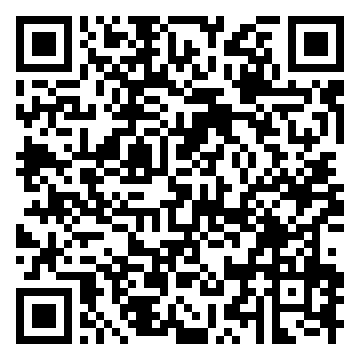

# Pizza Magna for the Nintendo 3DS (prototype)

Homebrew port with [LÖVE Potion](https://lovebrew.org) 3 (LÖVE for the 3DS, in Lua): the **Kitchen**, the **Menu**, the **Day**, the **Contest**, the **Shop** and the **City**. L/R go to the screen before and after (SELECT to the next one too); START opens **Options** (language, music on/off, volume, next song, save and quit, and the version). The header shows L, the screen before, this screen, the one after, R, the cash and the reputation.

Text is drawn from a bitmap font (Nunito, 12 to 28 px; see Files), sharp on the console; every screen has one line with its buttons at the bottom.

**Kitchen**
- **Bottom screen (touch):** on top New pizza (press twice if the pizza was never saved), Add to menu (Save changes when editing a menu pizza) and Menu; under them the pizza's name (tap it to rename); the pizza on the left (tap or drag to put pieces), and "Whole | Chopped" as words under it (tap one; tapping Whole again turns the next piece). On the right the picker: the groups as tabs in two rows (the topping groups with the phone pantry's symbols, then Dough and Sauce last) and the open group's toppings, doughs or sauces as icons below; tap a tab or an icon.
- **Top screen:** the chosen topping (its picture, price and weight a portion, whole or chopped, ♥ the group that loves it, topping of the week or least wanted, its combos), dough and sauce, the notes, and the analysis (quality, cost, suggested price, appeal by customer type). A toast shows each combo found.
- **Buttons:** the D-pad moves around the icons (hold to scroll); up from the first row goes to the tabs, where left/right change group and down comes back. A switches whole/chopped, X turns the piece, B undoes (on an empty pizza it brings back what Y cleared), Y clears.
- Adding a pizza needs at least 3 pieces. It goes on the menu at the suggested price; with no name it takes the name of its first combo, or "Pizza N".

**Menu**
- **Top screen:** the house menu, one row a pizza (small picture, name, dough and sauce, price, quality, margin), and a last row to create a new pizza. A pizza sold at a loss shows the warning on top; otherwise, when the chosen pizza is not the first choice of the customer group it suits best, the top line says why (as the browser game's Menu).
- **Bottom screen:** the chosen pizza, its price with - and +, quality, cost and margin, Edit recipe, Rename and Remove (press twice), and who picks it (the share of each customer group that would choose it).
- **Buttons:** D-pad up/down picks a pizza, left/right changes the price by $0.50 ($1 to $30, as in the browser game), A edits (or creates, on the last row), X renames, Y removes (press twice).
- Names use the console's keyboard (on a PC, type and press Enter).
- A new game starts with the three starter pizzas of the browser game.

**Day** ("Open")
- **Top screen:** the dining room, as in the browser game's day (`game/sala.lua`), at half size and centred: the shop's own room (as decorated in Shop › Decorate the room), the kitchen with the ovens you bought, the pizzaiolos and waiters of your team (the browser game's characters; a woman's name gets a woman's figure). Customers come down the street, go in (or walk past, or on to the rival), wait in the queue, sit, a waiter brings the pizza from the counter, they eat and walk out with a face over their head: happy (green), neutral (yellow) or unhappy (red; also those who gave up for the queue, a table or stock). A bubble shows each sale; night falls once the last ones leave. On the left the day, the clock and the takings so far; on the right how many left with each face. **Y** (before the doors open) switches the top screen to the **sales history** (as Menu › Sales history in the browser game): totals for the last 60 days (days, customers served, takings, profit, profit a day, best day), the profit of the last 30 days as bars, how customers left over those days (the three faces, as percentages), and the last three days with their best seller.
- **Bottom screen (touch):** the LCD (day, clock, popularity, customers expected / in the street, served, went to the rival, gave up, pizzaiolos, waiters, capacity, takings, cash), the contest banner on contest days, the neighbourhood news and the manager's notes. A (or the button) opens the doors; while the day runs, Pause (or B) stops the clock, x1/x2/x4 (or left/right) set the speed and resume, Skip to closing (or A) ends the day.
- **Report:** sales, toppings, rent, wages, the bank's interest (when you owe something) and the result, customers served, lost to the rival, in the queue or for a seat, how they left (the three faces with their counts, and how many of the unhappy were unhappy with the pizza or gave up), reputation before and after, the topping, least wanted topping and combo of the week; on the bottom screen who bought what (each pizza by customer group), what some customers said, the contest result and a tip. Bankrupt (debts over $500) starts a new game; the goal ($4000 and 3 stars) is announced once (off for now, as in the browser game: `GOAL_ON`).
- The simulation is the browser game's `simulateDay()` and `finishDay()`, staff included: the day serves the smaller of the kitchen's capacity (the pizzaiolos' speed, the ovens) and the waiters' (their speed), and cooking and charm add to each customer's satisfaction.
- Left out on the 3DS because they don't fit two small screens: the Pantry (toppings are bought on the day at +25%, as the browser game's manager does, with no manager fee), the manager setting prices or hiring, the recipe book, and the pizzeria's symbol (there is no share card on the 3DS).

**Contest**
- Every 5 days. The top screen shows the next theme and its rules, the prizes, the entry fee, how many points the rivals score, and the last contests. The bottom screen lists the menu pizzas with the points they would score (or why they're disqualified); tap one, or A, to enter it (the fee is paid once; swapping is free).

**City** (Porto Magno, as in the browser game)
- **Top screen:** the streets and houses (the browser game's pixel art, `game/gfx/city.png`) around the chosen building, with signs on the places to rent and for sale, pins on the rivals and on your shops (`*` the one open) and the landmarks. X zooms in (2x) and back.
- **Bottom screen (touch):** a navigator, the whole town small (`game/gfx/city_mini.png`) with a dot on each place to rent or for sale, rival and shop of yours, and a gold frame where the top screen is looking: touch it, or drag on it, to look there (the nearest building worth seeing is chosen). The D-pad jumps to the next one in that direction. Beside it, the chosen building: neighbourhood, status, address, foot traffic, condition and works, rent or price, a rival's strategy, a landmark's description, and the customers of its neighbourhood. With $4000 of your own money (cash minus loans) **A** (or the button) rents or buys it (press twice). On your shops: go to this shop, and **Y** closes a rented one or sells a bought one for 70% (press twice; never the only one).
- A new shop has its neighbourhood's customers, its street's foot traffic, its lot's rent (none if bought), the nearest rival with its neighbourhood's strategy (cheap, tourist, family, gourmet) and a reputation of 1 star plus a tenth of your best. Unlike the browser game it opens with the starter room and a copy of the open shop's menu (there is no recipe book on the 3DS; its room can be changed in Shop › Decorate the room). Each shop has its own menu, team, ovens, reputation, rival and history; the other shops run their day in the background, and the report lists each one and the total.

**Shop**
- Extra oven; **Team** (each pizzaiolo and waiter with name, wage, speed and cooking or charm as n/5; tap Let go, never the last of a role); **Looking for work today** (three new pizzaiolos and three new waiters every day; tap Hire, $100); neighbourhood flyers; the supplier (1/2/3: more quality, dearer toppings), the weekly market study (tips listed below it); the **Bank** (borrow $500, $2000 or $5000 up to $20,000, repay $500 or all; 0.5% of the debt a day); and restart the game (press twice). Hiring, letting go and the bank are touch buttons on the bottom screen.
- **Decorate the room** (as Shop › Decorate the room in the browser game): the catalogue on the top screen (L/R: tables, decor, on the wall, floor, walls; up/down to choose; A takes a piece, or buys a floor, a wall finish or the Christmas lights), the room on the touch screen. Touch a piece of the room and drag it: it follows the stylus, its frame green where it fits and red where not, and lands when the stylus lifts (or goes back where it was). A piece taken from the catalogue is dragged in the same way and paid when it lands; wall pieces go in one of the six slots of the back wall with a tap. X sells the selected piece for half its price, Y moves it (then touch where it goes), B cancels or goes back. Tables with no way in are crossed out in red; the top screen shows the seats and the atmosphere for each customer group, which the day uses. Each shop has its own room (`game/roomlib.lua` has the rules).

**Options** (START, from any screen; B or START closes them)
- Language (English or Português; English by default), music on or off, the volume (Low to Max, Quiet by default; left/right), the next song, and save and quit. The touch screen has the same as buttons. Music: the browser game's tunes, Italian and lo-fi (and the Christmas ones from 1 November to 31 January), in the same order as there (alternating lo-fi and Italian, shuffled, each once, never the same twice in a row), the first a minute after the game starts, then a new one every 3 minutes with silence in between. Kept in the save.

Everything is saved to `save.txt` (on the console in `sdmc:/3ds/save/pizzamagna/`; a failed write shows a toast and is tried again every 10 s): the pizza on the bench, the menu, the combos found and the restaurant (day, cash, reputation, the team and today's candidates, the loan, rival, news, contests, tips, the last 60 days of history). Saves from before the staff profiles had a count of pizzaiolos: they become average people (n pizzaiolos and ⌈2n/3⌉ waiters), as in the browser game. Pieces are stored in the same compact format as the browser game (`packPieces`, recipe links `#p=`).

## Files

- `game/main.lua`: screens, input and drawing. `game/pizza.lua`: the pizza rules (`analyze()` with the topping of the week and the supplier, `contestScore()`, portions, weights, `packPieces`) and `game/day.lua`: the restaurant (`simulateDay()`, `finishDay()`, `resolveContest()`, the shop, the market study), both ported by hand from `index.html`. **When those change in the browser game, change them here too.**
- `game/data.lua`: toppings, doughs, sauces, combos, customer groups, weights, the economy constants, the starter room's seats and atmosphere, the topping and combo of the week for 400 weeks, and the whole `I18N` table. **Generated** from `index.html` by `node tools/export_3ds.js`; never edit it by hand.
- `game/gfx/room.png`, `game/gfx/people.png` and `game/roomdata.lua`: every piece of the room atlas at half size (floors, walls, furniture, decor, kitchen, street), the characters of `assets/cast` at half size (cells 16x29), and what every piece is (`ITEMS` with its layout, `FLOORS`, `WALLS`), the starter room, the queue, the waiters' corner, the counter, the cooks, the guests and VIPs. **Generated** by `node tools/export_3ds_room.js` from `index.html`, `assets/room.js` and `assets/cast` (Chromium via Playwright). `game/sala.lua` (the room's people and paths, as `step()` and `drawRoom()` in `index.html`) is ported by hand.
- `game/music/<id>.ogg` and `game/musicdata.lua`: the tunes of `music.js` recorded (mono, 32 kHz, Vorbis, about 10 MB) with the same voices, in Chromium's offline Web Audio, and their titles, kinds and lengths. **Generated** by `node tools/export_3ds_music.js` (Playwright and ffmpeg); run it after changing `music.js`. `game/musica.lua` plays them (the order and the 3-minute rule of `music.js`, ported by hand).
- `game/gfx/city.png` and `game/gfx/city_mini.png`: the city map, 904x704 in a 1024x1024 picture, and the same map 152 wide for the navigator. **Generated** from `city.js` by `node tools/export_3ds_city.js` (it uses the Chromium that Playwright drives). The lots themselves (address, traffic, rent, price, condition) are in `data.lua`.
- `game/atlas.lua` and `game/gfx/atlas*.png`: the toppings atlas packed again in 1024x1024 pages (the 3DS limit), with the turning pieces already turned and shadowed (`<id>_q0..q3`) and the group symbols (`cat_<group>`, from `assets/menu-art.js`). `icon.png` (48x48). **Generated** from `assets/ingredients.js` by `python3 tools/export_3ds.py`.
- `game/gfx/font.png` and `game/fontdata.lua`: the letters, Nunito (SIL Open Font License, `tools/fonts/`) drawn at the four sizes the port uses (tiny 12, small 13, body 16, big 28 px), and where each glyph is. **Generated** by `node tools/export_3ds_font.js`; run it to add a size or a character (a character missing from the font is drawn as "?"). `game/bfont.lua` draws text from them.
- `lovebrew.toml`: settings for the bundler.

After adding toppings or changing data in the browser game, run both exporters again; after changing `city.js`, also `node tools/export_3ds_city.js`; after changing the room atlas, the starter room or the cast sheets, `node tools/export_3ds_room.js`.

## Putting it on a 3DS

Every push that changes `3ds/` builds the game in GitHub Actions (`.github/workflows/3ds.yml`) and publishes it in a release: from `main` in [**3ds-latest**](https://github.com/ruicasaisalves/pizza-magna/releases/tag/3ds-latest), from any other branch in `3ds-test`.

- **Installed in the HOME Menu, by QR code** (a console with custom firmware, Luma3DS): open FBI, **Remote Install › Scan QR Code**, and scan this code. FBI downloads `PizzaMagna.cia` and installs it; Pizza Magna then has its own icon and banner in the HOME Menu.

  

- **From the Homebrew Launcher:** copy `PizzaMagna.3dsx` from the release to `sdmc:/3ds/` and open it from the Homebrew Launcher.

Both need the console's sound firmware, `sdmc:/3ds/dspfirm.cdc` (made by DSP1 when custom firmware is installed, as in the 3ds.hacks.guide); without it the game stops at start with "Failed to initialize ndsp".

How it is built (`3ds/cia/`): `build.sh` runs in the devkitPro container and builds LÖVE Potion 3.0.2 from source with one small patch (`lovepotion-cia.patch`: it reads the game from `romfs:/game.love` when that file exists, because a LÖVE Potion installed as a `.cia` has no program file to find the game in; and it then keeps the saves on the SD card, `sdmc:/3ds/save/`, since LÖVE Potion would put them next to the game, in the read-only RomFS, and the first save closed the game). The game is a zip of `game/` with its PNGs turned into `.t3x` (`tex3ds -f rgba`, as the bundler does; LÖVE Potion opens `x.png` as `x.t3x`), placed in the RomFS of both the `.3dsx` and the `.cia`. `cia.sh` then packs the `.cia` with makerom on the runner itself (its Linux build needs a newer glibc than the container), with `app.rsf` (the usual homebrew template), the icon and `banner.png`/`banner.wav` for the HOME Menu. The title ID is `000400000F8A5700`.

By hand, without the workflow, the old way still works: zip `lovebrew.toml`, `icon.png` and the `game/` folder, upload the zip to <https://bundle.lovebrew.org>, and copy the `.3dsx` it gives to `sdmc:/3ds/`.

Text is drawn from a bitmap font (`game/bfont.lua`), letter by letter from `gfx/font.png`. The console's system font, scaled down to the small sizes, was blurred, each new system font copies about 3 MB (four of them crashed a New 3DS), and LÖVE Potion has no image fonts on the 3DS.

## Trying it on a PC

With [LÖVE](https://love2d.org) 11.4 or newer: `love 3ds/game`. The window shows the top screen above the bottom one, and the mouse works as the stylus (right-click turns the piece). Keys: arrows, Q/W = L/R, Z = A, X = B, S = X, A = Y, Tab = SELECT, Esc = START.

## Not tested yet

Runs on a New 3DS (Homebrew Launcher, bundled with bundle.lovebrew.org). The `.cia` from the workflow installs and runs in the Azahar emulator (the Kitchen at full speed); on a console it is still to be tried. Still to check: speed with many pieces (up to 300) on an old 3DS, the circular clip of big pieces (it uses a stencil; if the 3DS lacks it, a lobster's legs show past the crust), the touch coordinates, and the button names.
